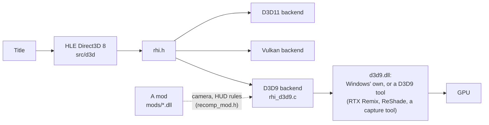
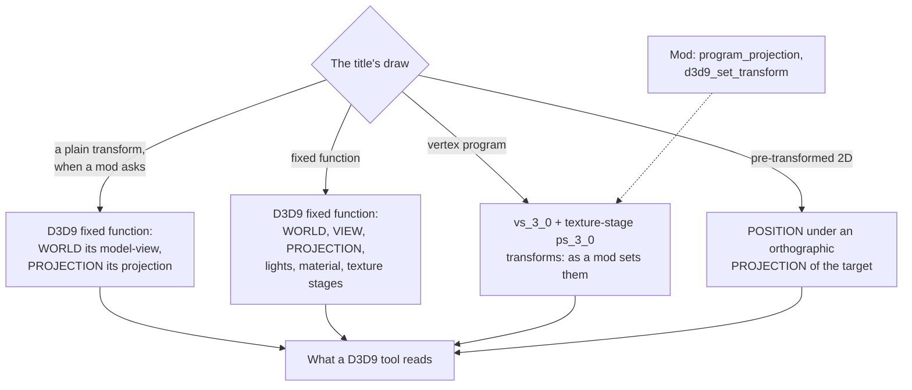

# A Direct3D 9 backend

**Status, October 2026:** runs TimeSplitters 2 at full speed under Windows'
own D3D9, and a captured frame replays pixel for pixel the same as D3D11. It
also runs under RTX Remix 1.6.1, which, with a mod for the title
(`src/hle/recomp_mod.h`, [mods.md](mods.md)), path-traces its levels in the
game's own world space. `RECOMP_D3D8_BACKEND=d3d9` chooses it. This note is
the design and what is left; `src/d3d/rhi_d3d9.c` and `rhi_d3d9.h` are the
reference.

## Why D3D9

A large body of PC tools works by sitting between a game and Direct3D 9:
RTX Remix (path tracing and asset replacement), ReShade-style post
processing, PIX and RenderDoc-style frame debugging, texture dumpers and
packs. They find a game's draws, transforms, textures and vertices through
the D3D9 API, so they work on a recompiled title only if it draws through
D3D9 the way a PC game of its era would. The backend's job is therefore less
"run on D3D9" than "look like a D3D9 game": fixed function where the title
was fixed function, vertex declarations that name what each input holds,
the scene drawn into a back buffer of its own size, and copies of the screen
made as copies rather than draws.

RTX Remix is the most demanding of these tools and the one the backend was
tested against, so its needs are the worked example below. Remix is a D3D9
runtime (dxvk-remix): its `d3d9.dll` beside an executable receives that
executable's D3D9 calls; the 64-bit runtime is used directly. It does not
read shaders. It rebuilds the scene from what a fixed-function D3D9 title
sets around each draw: `WORLD`, `VIEW` and `PROJECTION`, the texture in
stage 0, and the vertex declaration's `POSITION`, `NORMAL`, `COLOR0` and
`TEXCOORD`. For a draw through a vertex shader it captures the positions the
shader writes and carries them back to world space through the inverse
`PROJECTION` and `VIEW`. What a title-specific tool needs beyond that (the
camera hidden in a vertex program, which 2D is HUD) is not the renderer's
to guess: a mod supplies it.

## Where the seam goes

**Figure 1.** One renderer, three backends. The D3D9 backend draws the way a
PC D3D9 game of the era would, so a tool that replaces `d3d9.dll` sees
ordinary D3D9 calls; a mod fills in what only the title knows.

The renderer already draws through `rhi.h` (`vulkan-backend.md`). D3D9 is a
third backend behind it, and where D3D9 has to draw differently, the renderer
asks `rhi_d3d9_active()` and calls `rhi_d3d9.h`. Under the other two backends
nothing changes: the shared HLSL keeps its D3D11 text in the `#else` of each
`#ifdef RHI_D3D9`.

| What | D3D11 / Vulkan | D3D9 |
| --- | --- | --- |
| Fixed-function draw | the generic FFP shaders | D3D9's own fixed function: no shader, transforms, lights, material, render and texture-stage states handed over (`d3d8_shaders.c`, `d9_ff_prepare_draw`) |
| Pre-transformed (XYZRHW) | divide by the target's guest size in the VS | `POSITION` x, y, z under an orthographic `PROJECTION` of the guest target, so the viewport squeeze still applies and a D3D9 tool sees 2D as orthographic |
| Vertex program | vs_5_0 | vs_3_0 from the same generator: constants in registers c0, c192, c196; inputs named by what the program does with them, the XDK's register convention (v0 `POSITION`, v2 `NORMAL`, v3 `COLOR0`, v9 `TEXCOORD0`...) as the fallback |
| Pixel stage under a program | the generic FFP PS, or the combiner translator | a ps_3_0 written per combination of stage operations (`d9_ps_source`) |
| Register combiner program | translated, Shader Model 5 | translated, ps_3_0 under a vertex program and ps_2_a under fixed function (D3D9 pairs fixed function only with ps_2_x); one too long for ps_2_a draws stage 0's texture times diffuse |
| Alpha test | in the pixel shader | D3D9's own render state, title draws only (`rhi_d3d9_title_draw`) |
| Clear with rectangles | a quad per rectangle | D3D9 `Clear` with rectangles |
| Screen copy | a draw | `StretchRect` |
| Depth copy | a draw | the same draw in Shader Model 3, sampling `INTZ` |
| Display resolve | a box-filter draw to the swap chain | `StretchRect` to a back buffer the scene's size; `Present` stretches it into the window, bars drawn with GDI |
| Touch controls | drawn | not drawn |

## What a D3D9 tool sees

**Figure 2.** What each kind of draw hands a tool. Fixed function carries
its own transforms; a program draw's transforms come from a mod.

- **Fixed-function draws** carry the title's own `WORLD`, `VIEW` and
  `PROJECTION` (Hor+ applied to the projection as the D3D11 path applies it).
- **Program draws** carry nothing of their own: D3D9 ignores the transforms
  under a vertex shader, and the backend leaves them as they stand. A tool
  that follows a program's positions back into the world (Remix does) needs
  a `PROJECTION`, a `VIEW` from the title's camera and a `WORLD`; a mod sets
  them through `recomp_mod.h`, which hands it each program draw's
  projection: the program's own projection register (`proj_reg`, as
  uploaded: Hor+ and camera zoom applied) transposed to row-vector form.
  Without a mod those transforms are whatever they last were.
- **Plain transforms, on request.** A tool that rebuilds a scene has to read
  each program draw back out of a shader, draw by draw. A program that only
  takes a position through a model-view and a projection and passes a colour
  and coordinates on does nothing fixed function could not, so
  `nv2a_vsh_plain_transform` (`src/kernel/nv2a_vsh.c`) recognises it, and a mod
  can ask for it to be drawn that way (`d3d9_fixed_transform`, [mods.md](mods.md)).
  `WORLD` is then the model-view and `VIEW` identity, which draws the same; a
  mod that knows the camera moves it from one to the other. The XDK's two
  screen lines are folded into `PROJECTION`, which keeps the viewport's depth
  range; a program's scale on its coordinates is a texture transform, even at 1;
  each stage reads the input the program sends it, since one input may go to
  several stages; and a colour the program swizzles `.zyxw` has red and blue swapped in
  the vertices uploaded, because fixed function reads a `D3DCOLOR` as it stands.
  One combined matrix stays a program, having nothing to give `WORLD` and
  `PROJECTION` apart, as do draws with fog on, W-buffer draws, and combiners too
  long for ps_2_a. The log counts each reason (`[D3D9] plain transforms`).
  It is off without a mod: D3D9 itself gains nothing, and fixed function has no
  depth clamp, so a vertex past the far plane is cut.
  `RECOMP_D3D9_FIXED_TRANSFORM` (settings file `d3d9_fixed_transform`) has the
  last word, 0 never and 1 always. Forced on against plain D3D9, five recorded
  TimeSplitters 2 frames differ in 0.02-0.5% of their pixels, nearly all by 1 or
  2 levels of 255. Under Remix, with every room drawn (about 2,160 draws), 76% of
  program draws go this way and a frame falls from 32 ms to 23 ms (31 to 42.6 fps).
- **Inputs named for what they hold.** A D3D9 tool reads a draw through the
  declaration's usages: `POSITION` for its vertices, `COLOR0` for vertex
  colour (Remix leaves out a draw without a `POSITION`, and reads `COLOR0` in
  `D3DCOLOR` only). A title lays
  out its own programs' inputs, and the XDK's habit (v0 position, v2 normal, v3
  colour, v9 texture) is only a habit: TimeSplitters 2 keeps its level's
  position in v1, its colour in v2 and its texture coordinates in v3. Named by
  habit, the colour was a normal and the coordinates a colour, and a tool
  reading the declaration got both wrong (Remix logged `Unsupported color0
  buffer format` and lost all vertex colour). So
  `vsh_input_attrs` (d3d8_vsh.c) follows each input through the program to its
  outputs, and names it there. An input rotated by three `DP3`s is the normal
  even when, as in a lit program, nothing but `oD0` comes of it. The habit is
  only the fallback, for an output
  two inputs feed. A program that sends no input to `oPos` still gets its
  first three- or four-float register as an unread `POSITION0`. A program and
  its declaration change together, so plain D3D9 draws the same pixels (35
  TimeSplitters 2 frames compared, none different), and any other tool reading
  the declaration gets the truth too.
- **The viewport correction.** D3D9 needs the viewport inside the target and
  puts pixel centres half a pixel off D3D10's. The backend clamps the viewport
  and corrects clip space with `RHI_VP_ADJUST` (c255) in every vertex shader,
  and folds the same correction into `PROJECTION`, so a tool that inverts
  the transforms gets exactly what was rasterised.
- **No depth clamp.** D3D9 always clips to `0 <= z <= w`; D3D11 runs the
  title's draws with depth clip off. Where the raster state asks for that,
  `RHI_VP_ADJUST` clamps each vertex's z into range (flag at c254), so a
  level's far walls and sky are drawn at the far plane rather than cut away.
- **The screen-space undo branches.** Flattened by fxc for Shader Model 3, the
  end of every generated vertex program blended the clip position with the
  raw screen position, whose z is in depth-buffer units (~1.6e7), and lost
  every clip z below 1 in fp32. It is `[branch]` under D3D9.
- **The back buffer is the scene's size**, because tools take the draws into
  a target of the back buffer's size for the scene (Remix only those). The
  window is filled by `Present`'s destination rectangle.

## D3D9 against D3D11, inside the backend

Constant buffers become CPU copies uploaded to fixed registers per (stage,
slot); index data stays on the CPU and each indexed draw copies its range into
a 16- or 32-bit streaming buffer; a draw with no vertex layout reads its
vertex number from an internal `TEXCOORD15` stream; formats D3D9 lacks are
converted on upload (R8G8B8A8 swapped to A8R8G8B8, R8/R8G8 and the 16-bit
one- and two-channel formats widened, A8 stored white as the Xbox samples it);
sampled depth is `INTZ`. There is no device `Reset`: a windowed device is not
lost, and the back buffer keeps its size.

## Trying it

1. Build as usual (MSVC). Nothing links `d3d9.lib`: `d3d9.dll` is loaded at
   run time, so a tool's own `d3d9.dll` beside the executable is found
   before the system's.
2. Without a tool first: `RECOMP_D3D8_BACKEND=d3d9`, with the system's D3D9.
   The picture should match D3D11's apart from long register-combiner
   programs under fixed function ([d3d9-parity.md](d3d9-parity.md)).
3. With a D3D9 tool, for example RTX Remix: copy its 64-bit runtime
   (`d3d9.dll`, `.trex/` and the rest of the runtime package) beside the
   executable, and run with the same setting.
   Alt+X opens Remix's menu. Without a mod for the title, Remix sees it as a
   plain D3D9 game; title-specific setup (which 2D is HUD, the camera of its
   program draws) belongs in a mod and the title's own Remix configuration,
   not in the toolkit.

## Known gaps

[d3d9-parity.md](d3d9-parity.md) lists every place this backend draws
differently from D3D11. What a particular tool needs told about a title (its
2D, sky and post passes, the camera of its program draws) is not the
renderer's: a mod does it through the per-draw hooks in
`src/hle/recomp_mod.h` ([mods.md](mods.md)).

- A register combiner program too long for ps_2_a, under fixed function, is
  approximated (stage 0's texture times diffuse). Under fixed function the
  combiners' fog register reads no fog; D3D9's fog unit fogs the result.
- A sky drawn as a plain transform came out black under RTX Remix on
  TimeSplitters 2's Mexican, though Siberia's looked right and plain D3D9 draws
  both. Not understood; dropping the texture transform did not help. A mod can
  leave any draw a program (`keep` in `d3d9_fixed_transform`), and TS2-RTX does
  for its sky.
- Without a texture transform at a scale of 1, the picture TimeSplitters 2 shows
  on its scanner went missing under RTX Remix. Not understood either, so the
  program's scale is always set.
- Vertex blending (skinned fixed-function) is ignored, as under D3D11.
- Point sprites are one pixel, as under D3D11.
- Frame interpolation is untested under D3D9.
- `RECOMP_RES_SCALE` above 1 renders larger, but is not box filtered: the back
  buffer is the scene and `Present` scales it.
