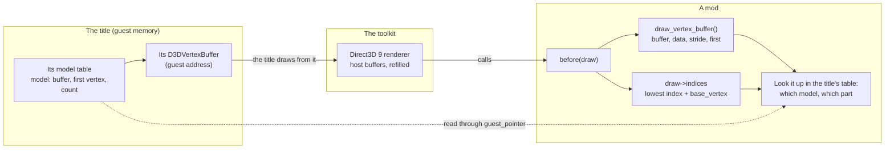

# Mods

A recompiled title is a native program, so a player can change it the way PC
games have long been changed: by dropping a library beside it. The toolkit
gives such libraries one small, versioned C contract,
[`src/hle/recomp_mod.h`](../../src/hle/recomp_mod.h), so that a change to a
title can live outside the title's build: the port stays the port, and a mod
is something a player chooses to add.

This page is what a mod can do, how it is loaded, and what belongs in one
rather than in the toolkit or a title's port.

## What a mod is for

Anything that changes or adds to a title without being part of it:

- **Graphics add-ons:** a texture or model pack, a post-processing pass, a
  HUD tweak, support for a D3D9 tool such as RTX Remix
  ([d3d9-backend.md](d3d9-backend.md)) that needs to be told things about
  one title (its camera, which 2D is HUD).
- **Tools:** a frame debugger's markers, a texture or mesh dumper, an
  overlay showing the title's own state.
- **Experiments and fixes:** something a player wants to try on one title,
  without a rebuilt executable.

What a mod gets is general: nothing in the contract names a title or a
particular tool. A mod for one title checks the title it is loaded into and
unloads itself from any other.

## Loading

- Every `.dll` (Windows) or `.so` (elsewhere) in the folder `mods` beside
  the executable, in name order, that exports `recomp_mod_init`.
- `RECOMP_MOD_LIBS=0` loads none; `RECOMP_MOD_LIBS_DIR` names another folder.
- They are loaded once, as the title makes its Direct3D device (before the
  first draw). `recomp_mod_init` returns nonzero to stay loaded.
- `d3d8_replay` loads them too when it replays a frame capture, so a mod's
  effect can be checked on the same frames again and again.

A title's own asset mods (for example split2-recomp's `RECOMP_MODS` folders,
which replace files the title reads) are a different thing: they change data,
not code.

## What a mod can do

| Area | What the contract gives |
| --- | --- |
| The title | its ID and name; read access to its memory (`guest_pointer`); a call once a frame; the vertex-program constants of the draw in hand; a log line |
| Draws (Direct3D 9 renderer) | a call before and after every draw, with what the renderer knows of it (the title's or the toolkit's, 2D or 3D, fixed function or program, the program's projection, textures and screen copies bound, depth state, vertices and indices, and which of the title's own vertex buffers it reads: see [Telling a title's models apart](#telling-a-titles-models-apart)); the draw may be changed for that one call or left out |
| Device events | device made, clears, copies of the screen into a texture (the mod may supply the surface to read instead), before `Present` |
| Shaders and state | vertex HLSL added in front of every program (`RHI_MOD_POSITION`); render states as last set; the fixed-function transforms; the projection |
| Textures | textures the CPU rewrites after they were drawn with can be made anew, for tools that recognise a texture by its contents |
| Captures | a mod's own notes stored in a frame capture as it is made and handed back at the same point of a replay, for a mod that reads the title's memory |

The per-draw hooks exist under the Direct3D 9 renderer today; under D3D11
and Vulkan a mod still loads and gets the title-level calls.

## The contract

`recomp_mod.h` stands alone: a mod is built against a copy of it, not
against the toolkit. Fields are only ever added at the end; a mod checks the
table's `size` before using one newer than it knows, and `version` names the
newest set. The header itself is the reference for every field.

A minimal mod:

```c
#include "recomp_mod.h"

static const RecompModApi *g_api;

static void each_frame(void *user)
{
    (void)user;
    /* read the title's state through g_api->guest_pointer, ... */
}

int recomp_mod_init(const RecompModApi *api)
{
    if (api->version < 3 || api->title_id() != 0x12345678u)
        return 0;                       /* not ours: unload */
    g_api = api;
    api->on_frame(each_frame, NULL);
    return 1;
}
```

## Telling a title's models apart

A mod that changes one thing in a title (one character, one gun, one kind
of wall) first has to recognise that thing's draws. What the renderer hands
a mod is the host's copy: host vertex buffers that are filled and refilled,
so their addresses say nothing about where the vertices came from. The
title's own buffers do. A title loads a model into vertex buffers of its own
and keeps them, and its own data says which model is where.
`draw_vertex_buffer` (version 4) gives the mod that link: from inside a
draw's `before` or `after`, which of the title's `D3DVertexBuffer`s the draw
reads.



What it gives, for the draw in hand:

| Out | Meaning |
| --- | --- |
| return value | the guest address of the title's `D3DVertexBuffer`, or 0 when the vertices came from no buffer of the title's (drawn from memory, a toolkit draw) or in a replay |
| `*data` | the guest address of that buffer's vertex data |
| `*stride` | bytes per vertex, as the title set the stream |
| `*first` | the first vertex the draw reads from it (the base vertex, for an indexed draw) |

The vertices a draw uses are then `first` plus the draw's own range: for an
indexed draw the lowest of `draw->indices` plus `draw->base_vertex`, for any
other `draw->first_vertex`. Buffer, stride and vertex range together are
what a mod looks up in the title's own tables, read through
`guest_pointer`. Those tables are the title's business, so the lookup lives
in the mod (or the title's port); the toolkit only says which buffer.

```c
static int before(RecompModDraw *d, void *user)
{
    uint32_t data, stride, first, lo;

    if (!RECOMP_MOD_HAS(g_api, draw_vertex_buffer) ||
        !g_api->draw_vertex_buffer(&data, &stride, &first))
        return RECOMP_DRAW_AS_IS;       /* not from one of the title's buffers */
    lo = first + (d->indexed ? lowest_index(d) + d->base_vertex : d->first_vertex);
    if (is_the_model_i_want(data, stride, lo))   /* the title's own tables */
        return RECOMP_DRAW_SKIP;        /* or change it, or draw something else */
    return RECOMP_DRAW_AS_IS;
}
```

`RECOMP_MOD_HAS(api, field)` says whether the toolkit a mod is loaded into
has a field newer than the oldest one the mod supports, so one build of a
mod runs on an older toolkit too, with that feature off.

Things to know:

- It answers only inside a draw's `before` or `after`, and only for the
  title's own draws.
- With the title's draws deferred to the end of the frame
  (`RECOMP_HLE_D3D8_DEFER`), the buffer is still right, but whatever else a
  mod reads from guest memory at the draw shows the end of the frame.
- In a replay there is no guest memory, and it returns 0.
- A title that writes each frame's vertices into one ring buffer (particles,
  text, some skinned meshes) gives the ring's address every time; a mod
  tells those draws apart some other way (the vertex constants, the
  textures).

## Where a change belongs

- **The toolkit** gets what serves any title: renderer behaviour every
  title needs, and general hooks a mod can use. A hook is described by what
  it does (a draw, a copy, a texture rewritten), never by the one tool or
  title that first wanted it.
- **A title's port** gets what that title needs on any renderer: its fixes,
  its controls, its own modding support (reading its archives, unlocking its
  content).
- **A mod** gets what one title needs for one tool or one change, for
  example RTX Remix support for a particular game: its camera, its HUD
  rules, its configuration.
