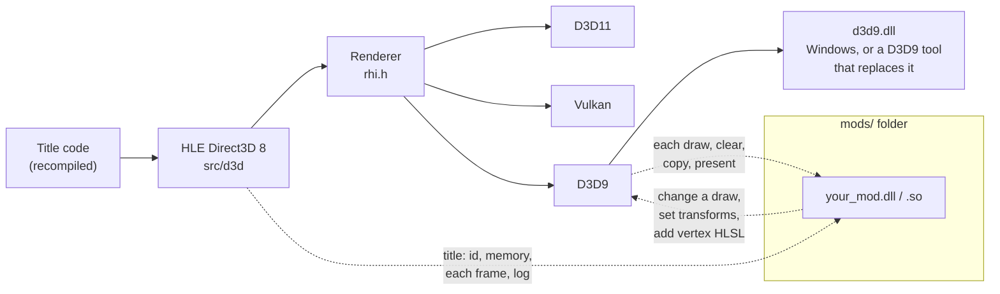
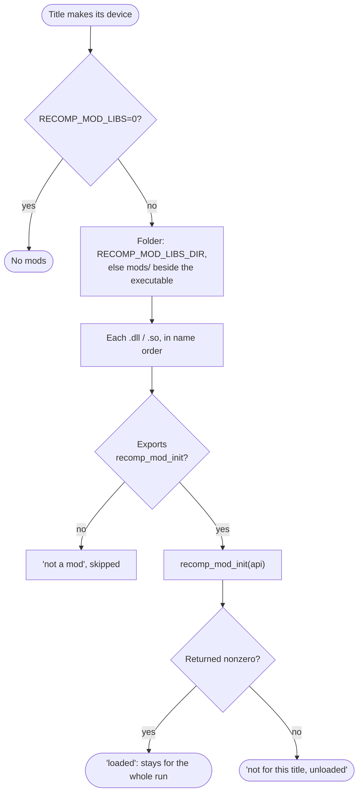
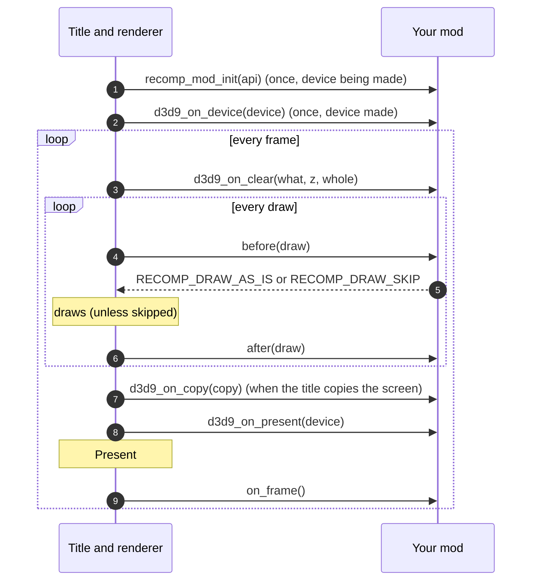
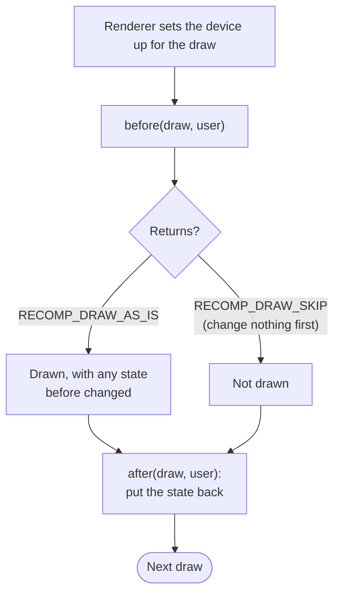
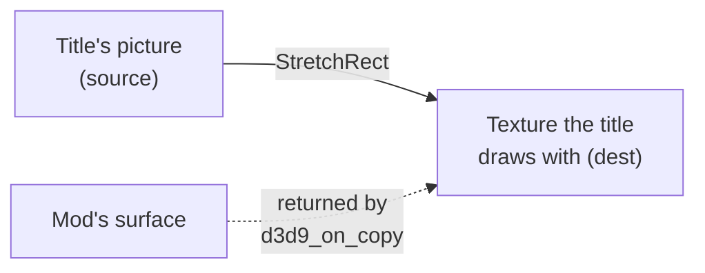
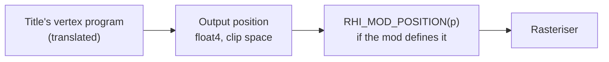
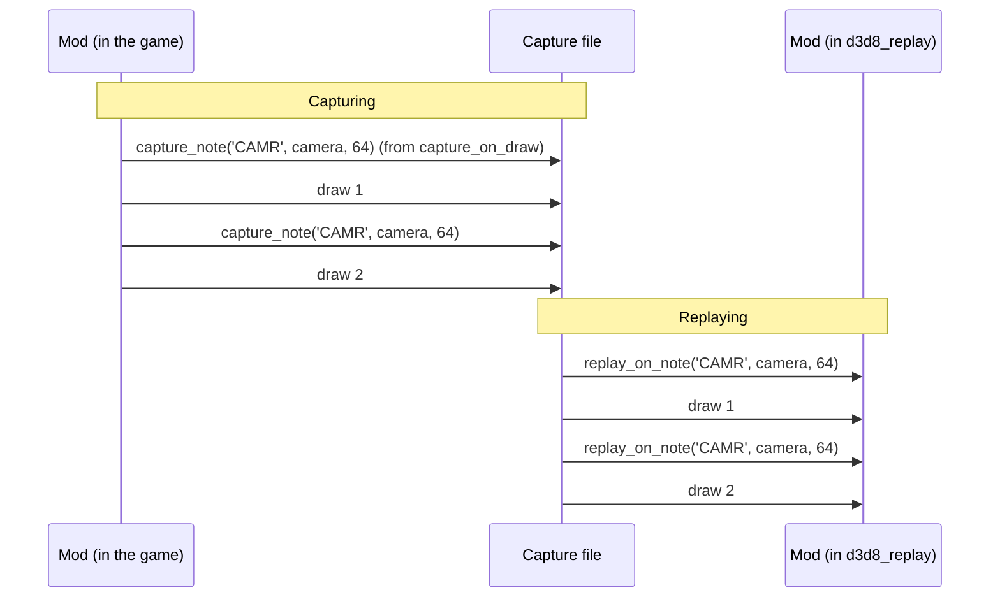
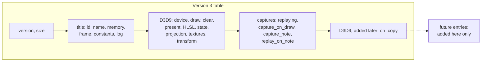
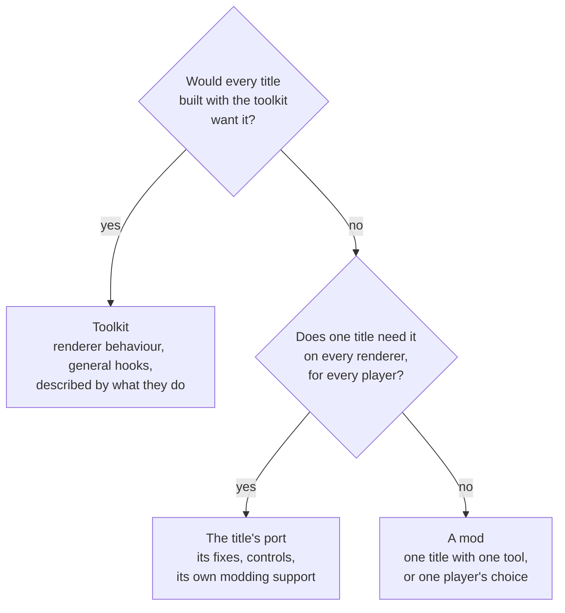

# Mods

A recompiled title is a native program, so a player can change it the way PC
games have long been changed: by dropping a library beside it. The toolkit
gives such libraries one small, versioned C contract,
[`src/hle/recomp_mod.h`](../../src/hle/recomp_mod.h), so that a change to a
title can live outside the title's build: the port stays the port, and a mod
is something a player chooses to add.

This page is the modder's guide: what a mod can do, how to build and load
one, every hook with when it is called, and what belongs in a mod rather
than in the toolkit or a title's port. The header is the field-by-field
reference; this page is the map.

**Contents:** [At a glance](#at-a-glance) ·
[Where a mod sits](#where-a-mod-sits) ·
[Your first mod](#your-first-mod) · [Loading](#loading) ·
[A frame, hook by hook](#a-frame-hook-by-hook) ·
[Hook reference](#hook-reference) · [Changing a draw](#changing-a-draw) ·
[Screen copies](#screen-copies) ·
[Vertex programs](#vertex-programs-rhi_mod_position) ·
[Captures and replays](#captures-and-replays) ·
[Versions](#versions-and-compatibility) ·
[Where a change belongs](#where-a-change-belongs) ·
[Troubleshooting](#troubleshooting)

## At a glance

| You want to... | Use | Renderer |
| --- | --- | --- |
| Read the title's state (score, health, camera) each frame | `guest_pointer` + `on_frame` | any |
| Show something in the game's log | `log` | any |
| Hide, recolour or retexture particular draws | `d3d9_on_draw` | D3D9 |
| Tell a D3D9 tool where the camera is | `d3d9_set_transform` from `before` | D3D9 |
| Move or bend every vertex program's output | `d3d9_vertex_hlsl` | D3D9 |
| Replace what a mirror, monitor or blur reads | `d3d9_on_copy` | D3D9 |
| Do something at the start or end of a frame | `d3d9_on_clear`, `d3d9_on_present` | D3D9 |
| Test the same frame again and again | a capture, `replaying`, `capture_note` | D3D9 replay |

Mods are what that picture's examples are: graphics add-ons (texture packs,
post-processing, HUD tweaks, support for a D3D9 tool such as RTX Remix in one
game, see [d3d9-backend.md](d3d9-backend.md)), tools (a frame debugger's
markers, a dumper, an overlay) and experiments a player wants to try without
a rebuilt executable. Nothing in the contract names a title or a tool: a mod
for one title checks the title it is loaded into and unloads itself from any
other.

## Where a mod sits

**Figure 1.** The title's own code draws through the toolkit's Direct3D 8
layer and renderer. A mod is a separate library beside the game; the toolkit
hands it the hooks (dashed) and it never links against the toolkit.



Under D3D11 and Vulkan a mod still loads and gets the title-level calls (the
top dashed line); the per-draw hooks are the D3D9 renderer's
(`RECOMP_D3D8_BACKEND=d3d9`).

## Your first mod

**Figure 2.** What goes where. The game folder is whatever folder holds the
title's executable.

```text
<game folder>/
├── game.exe                 the recompiled title
└── mods/
    └── hello_mod.dll        your mod (hello_mod.so on Linux and macOS)
```

1. **Copy the header.** `recomp_mod.h` stands alone (it includes only
   `<stdint.h>`). Put a copy beside your source; you do not build against the
   toolkit.
2. **Write `recomp_mod_init`.** Check the version and the title, register the
   hooks you want, return 1 to stay loaded.

   ```c
   #include "recomp_mod.h"

   #ifdef _WIN32
   #define MOD_EXPORT __declspec(dllexport)
   #else
   #define MOD_EXPORT __attribute__((visibility("default")))
   #endif

   static const RecompModApi *g_api;
   static unsigned g_frames;

   static void each_frame(void *user)
   {
       (void)user;
       if (++g_frames % 600 == 0)
           g_api->log("hello: ten more seconds at 60 fps");
       /* read the title's state through g_api->guest_pointer(...) */
   }

   MOD_EXPORT int recomp_mod_init(const RecompModApi *api)
   {
       if (api->version < 3 || api->title_id() != 0x12345678u)
           return 0;                       /* not ours: unload */
       g_api = api;
       api->on_frame(each_frame, NULL);
       api->log("hello: loaded");
       return 1;
   }
   ```

3. **Build it as a shared library** (64-bit, like the game):

   | Platform | Command |
   | --- | --- |
   | Windows, MSVC | `cl /LD /O2 hello_mod.c /Fe:hello_mod.dll` |
   | Windows, clang or MinGW | `clang -shared -O2 hello_mod.c -o hello_mod.dll` |
   | Linux | `cc -shared -fPIC -O2 hello_mod.c -o hello_mod.so` |
   | macOS | `cc -shared -fPIC -O2 hello_mod.c -o hello_mod.so` |

4. **Drop it in `mods/` and start the game.** The log says what happened:

   ```text
   [MOD] hello_mod.dll: loaded
   [MOD] 1 of 1 in mods loaded
   [MOD] hello: loaded
   ```

## Loading

**Figure 3.** How the toolkit decides which libraries are mods. It runs once,
as the title starts making its Direct3D device, so before the title's first
draw.



| Setting | Effect |
| --- | --- |
| *(nothing)* | every mod in `mods/` beside the executable |
| `RECOMP_MOD_LIBS=0` | no mods at all, for comparing with and without |
| `RECOMP_MOD_LIBS_DIR=<folder>` | mods from that folder instead |

Name order is load order, and for hooks where the first answer wins
(`d3d9_on_copy`) it is priority: prefix names (`10_`, `20_`) to choose.

A title's own asset mods (for example split2-recomp's `RECOMP_MODS` folders,
which replace files the title reads) are a different thing: they change data,
not code, and need no library.

## A frame, hook by hook

**Figure 4.** The order in which a loaded mod hears of things. Everything
after `recomp_mod_init` is called on the game's render thread, so a mod needs
no locks of its own between its hooks.



Clears and copies come where the title makes them, in among the draws; the
figure shows one of each.

## Hook reference

**Figure 5.** Every entry in `RecompModApi`, when it applies, and under which
renderer. ✓ works, – does nothing (or returns 0 / NULL).

| Entry | Called or usable | D3D11 / Vulkan | D3D9 | D3D9 replay | Limit |
| --- | --- | :---: | :---: | :---: | --- |
| `title_id`, `title_name` | any time | ✓ | ✓ | ✓ | |
| `guest_pointer` | any time | ✓ | ✓ | – (NULL) | |
| `on_frame` | after each frame is shown | ✓ | ✓ | ✓ | 16 |
| `vertex_constants` | inside a draw hook | ✓ | ✓ | – (0) | |
| `log` | any time | ✓ | ✓ | ✓ | |
| `d3d9_on_device` | once, device made | – | ✓ | ✓ | 8 |
| `d3d9_on_draw` | before and after each draw | – | ✓ | ✓ | 8 |
| `d3d9_on_clear` | each clear | – | ✓ | ✓ | 8 |
| `d3d9_on_present` | before each Present | – | ✓ | ✓ | 8 |
| `d3d9_vertex_hlsl` | from init only | – | ✓ | ✓ | one block |
| `d3d9_render_state` | inside a draw hook | – | ✓ | ✓ | |
| `d3d9_set_projection` | from `before` | – | ✓ | ✓ | |
| `d3d9_set_transform` | from `before`, or any time | – | ✓ | ✓ | |
| `d3d9_remake_written_textures` | from init | – | ✓ | ✓ | |
| `d3d9_on_copy` | before each screen copy | – | ✓ | ✓ | 8 |
| `replaying` | any time | ✓ (0) | ✓ (0) | ✓ (1) | |
| `capture_on_draw`, `capture_note` | while a capture is made | – | ✓ | – | 8 |
| `replay_on_note` | during a replay | – | – | ✓ | 8 |

"Limit" is across all loaded mods; a registration past it returns 0, so check
it.

## Changing a draw

`d3d9_on_draw` takes two functions. `before` sees a `RecompModDraw` describing
the draw, after the renderer has set the device up for it; it may change the
device for this one draw or leave the draw out. `after` runs once it is drawn
and puts back what `before` changed.

**Figure 6.** One draw through a mod's hooks.



**Figure 7.** What `RecompModDraw` tells you, grouped.

| Group | Fields | Use it to recognise... |
| --- | --- | --- |
| Whose | `title`, `two_d`, `title_2d`, `clip_w`, `offscreen` | the title's 3D, its 2D (HUD, menus), what goes to a texture |
| How | `program`, `program_id`, `primitive`, `primitives` | a particular vertex program, by bytecode hash |
| Textures | `textures[8]`, `texture_ids[8]`, `screen_copies` | a texture by what it holds (`texture_ids` is the same across runs and replays) |
| Depth | `depth_state`, `depth_enable`, `depth_write`, `depth_func` | sky, overlays, decals |
| Transforms | `projection_set`, `projection`, `world`, `view`, `program_projection_set`, `program_projection` | the camera, for fixed function and for programs |
| Geometry | `indexed`, `first_vertex`, `vertices`, `indices`, `index_bytes`, `index_count`, `base_vertex` | a draw by its shape, or to read its vertices |

**Example: hide the title's 2D**, for clean screenshots.

```c
static int hide_2d(RecompModDraw *d, void *user)
{
    (void)user;
    return (d->title && d->two_d) ? RECOMP_DRAW_SKIP : RECOMP_DRAW_AS_IS;
}

/* in recomp_mod_init: */
if (!api->d3d9_on_draw(hide_2d, NULL, NULL))
    api->log("no room for another draw hook");
```

**Example: change one draw's state and put it back.** The device is a plain
`IDirect3DDevice9`; any D3D9 call is allowed.

```c
static DWORD g_saved_fill;

static int wireframe_before(RecompModDraw *d, void *user)
{
    IDirect3DDevice9 *dev = d->device;
    IDirect3DDevice9_GetRenderState(dev, D3DRS_FILLMODE, &g_saved_fill);
    IDirect3DDevice9_SetRenderState(dev, D3DRS_FILLMODE, D3DFILL_WIREFRAME);
    return RECOMP_DRAW_AS_IS;
}

static void wireframe_after(RecompModDraw *d, void *user)
{
    IDirect3DDevice9_SetRenderState(d->device, D3DRS_FILLMODE, g_saved_fill);
}
```

Rules of thumb:

- **Put back everything** `before` changed, in `after`. The renderer caches
  state and will not set again what it believes is already set.
- **Skip only unchanged draws.** `RECOMP_DRAW_SKIP` means "before changed
  nothing"; `after` is still called.
- **Recognise draws by what they are**, not by their order in the frame:
  texture IDs, program hashes, 2D or 3D, depth state. Order changes with the
  camera.
- **Transforms that stay**: `d3d9_set_transform` is kept for later draws too,
  until the title or a mod sets it again. Set it on every draw it should
  apply to.

## Screen copies

Titles copy the picture into a texture to show it on something (a monitor, a
mirror, a scope) or to blur it. Under D3D9 that is a `StretchRect`, and
`d3d9_on_copy` hears of it first.

**Figure 8.** A mod can supply a surface to be read instead, for example one
it drew itself.



The callback gets a `RecompModCopy` (device, source, dest, and the rectangle
if not the whole). It returns an `IDirect3DSurface9` to read instead, with
the rectangle where it is in `source`, or NULL to leave the copy as it is.
The mod keeps its reference. With several mods, the first non-NULL answer,
in load order, stands.

## Vertex programs: `RHI_MOD_POSITION`

A title's own vertex programs are translated by the toolkit; a mod cannot
edit them one by one, but it can add HLSL in front of every one of them,
from `recomp_mod_init`, before the first is compiled.

**Figure 9.** Where the mod's HLSL runs.



```c
api->d3d9_vertex_hlsl(
    "#define RHI_MOD_POSITION(p) mod_position(p)\n"
    "float4 mod_position(float4 p) { p.x *= 0.75; return p; }\n");
```

The renderer's own `rhi_depth_clamp` (c254) is declared before the mod's text;
its `w` is always 0. The call returns 0 if the text does not fit.

## Captures and replays

A frame capture records every Direct3D call of a few frames
(`RECOMP_D3D8_CAPTURE_AT`); `d3d8_replay` plays them back without the title.
Mods load there too, so a change can be checked on exactly the same frames
again and again, and compared with the mod off (`RECOMP_MOD_LIBS=0`).

The title is not running in a replay: `guest_pointer` returns NULL. A mod
that reads the title's memory stores what it needs as notes in the capture,
and gets them back at the same point of the replay.

**Figure 10.** Notes go into the capture beside the draws and come back in
order.



```c
#define TAG_CAMERA 0x524D4143u   /* 'CAMR', little-endian */

static float g_camera[16];

static void note_camera(void *user)           /* capture_on_draw */
{
    read_camera_from_guest(g_camera);          /* your code */
    g_api->capture_note(TAG_CAMERA, g_camera, sizeof g_camera);
}

static void got_note(uint32_t tag, const void *data, uint32_t bytes, void *user)
{
    if (tag == TAG_CAMERA && bytes == sizeof g_camera)
        memcpy(g_camera, data, bytes);
}

/* in recomp_mod_init: */
if (api->replaying())
    api->replay_on_note(got_note, NULL);
else
    api->capture_on_draw(note_camera, NULL);
```

With the title's calls deferred (`RECOMP_HLE_D3D8_DEFER`), draws are written
to the capture when the frame's queue runs, at its end, so guest memory then
shows the end of the frame.

## Versions and compatibility

**Figure 11.** `RecompModApi` and `RecompModDraw` only grow at the end. A mod
built against an older header still works with a newer game; a mod that uses
a newer entry checks `size` first.



```c
#include <stddef.h>   /* offsetof */

#define HAS(api, field) \
    ((api)->size >= offsetof(RecompModApi, field) + sizeof((api)->field))

if (HAS(api, d3d9_on_copy))
    api->d3d9_on_copy(my_copy, NULL);
```

`version` names the newest set the game knows. Versions 1 and 2 were never
released; 3 is the first stable layout.

## Where a change belongs

The toolkit serves many titles, each title's port serves one title on every
renderer, and mods hold the rest. Keeping to this lets each piece be shared
with the people it is useful to.

**Figure 12.** Deciding where a change goes.



| | Toolkit | A title's port | A mod |
| --- | --- | --- | --- |
| Serves | any title | one title, any renderer | one title, one tool or choice |
| Examples | a draw hook, a copy hook, rewritten textures made anew | reading its archives, unlocking its content, mouse controls | RTX Remix support for one game: its camera, HUD rules, configuration |
| A hook is named | by what it does (a draw, a copy) | by the title's own terms | as the mod likes |
| Not here | anything one title or one tool alone needs | anything one tool alone needs | anything every player of the title needs |

## Troubleshooting

| The log says... | Meaning | Fix |
| --- | --- | --- |
| nothing about `[MOD]` | no `mods` folder, or `RECOMP_MOD_LIBS=0` | make `mods/` beside the executable; check the environment |
| `could not load (126)` (Windows) | the DLL needs another DLL that is missing | build with the static runtime (`/MT`) or ship the dependency |
| `could not load (193)` (Windows) | 32-bit DLL in a 64-bit game | build 64-bit |
| `no recomp_mod_init, not a mod` | the function is not exported | add `__declspec(dllexport)` and `extern "C"` in C++ |
| `not for this title, unloaded` | `recomp_mod_init` returned 0 | check the title ID and `version` test |
| `loaded`, but draw hooks never run | the game is not on the D3D9 renderer | `RECOMP_D3D8_BACKEND=d3d9` |
| a hook registration returns 0 | that hook's limit is full across mods | fewer mods, or one hook dispatching to several handlers |
| the picture is wrong after the mod's draw | `after` did not put back what `before` changed | restore every state you set |
